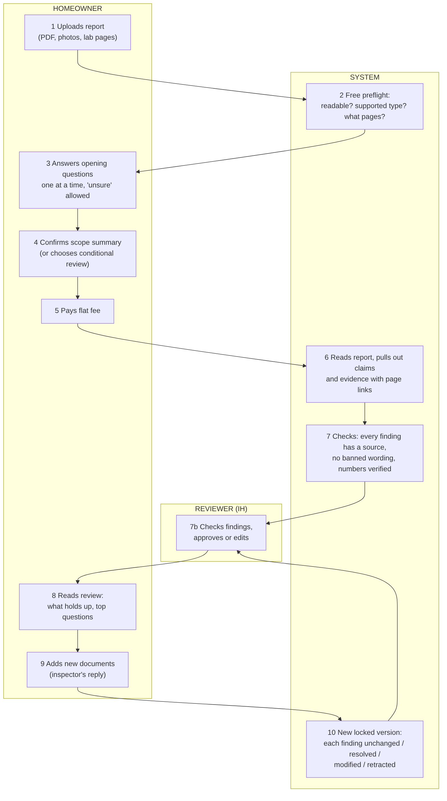

# Workflow

Source: `journey.mmd` (Mermaid). Rules for each step live in `docs/spec/MASTER_SPEC.md` sections 6, 15, 18 and in `packages/domain`.

## Where the reviewer (IH) input is needed
- Step 7b: what a reviewer checks, how fast, what they may edit.
- Rule files for step 6-7 (`data/rules/`): how to read causes, sampling, protocols.
- Which kinds of reports are in scope for the first release.

Later (not in the first release): unattended release without reviewer approval, only after validation.
